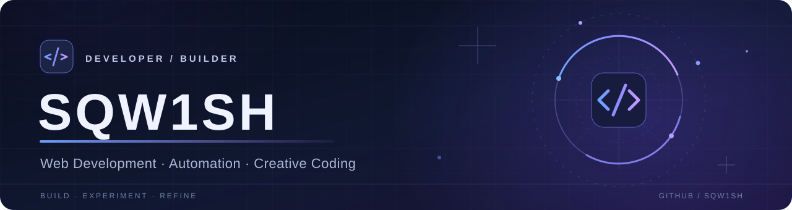

<div align="center">
  

  <br />

  **Building useful things for the web, automating workflows, and experimenting with game systems.**

  <a href="https://github.com/sqw1sh/portfolio-site">
    
  </a>
  <a href="https://github.com/sqw1sh?tab=repositories">
    
  </a>
</div>

---

### About me

Hi, I'm **sqw1sh**. I enjoy building clean web interfaces, working on practical tools, and exploring software development beyond the browser.

- **Web:** responsive interfaces and applications built with modern JavaScript tools.
- **Automation:** learning Python and building skills in practical workflow automation.
- **Creative development:** exploring custom systems for Minecraft modding.
- **Collaboration:** interested in freelance web and automation projects.

### Toolbox

<div align="center">
  
</div>

### Featured projects

| Project | What it's about |
| :--- | :--- |
| **[Portfolio & Web Apps](https://github.com/sqw1sh/portfolio-site)** | A React + TypeScript + Vite portfolio with three local MVP applications: **TraceShelf**, **QuietSlot**, and **RePair Atlas**. |

### What I'm focusing on

```text
01  Build polished, accessible web interfaces
02  Improve Python and automation skills
03  Develop and refine creative game systems
```

---

<div align="center">
  <sub>Always learning. Always building.</sub>
  <br />
  <sub>🇷🇺 Также открыт к сотрудничеству на русском языке.</sub>
</div>
